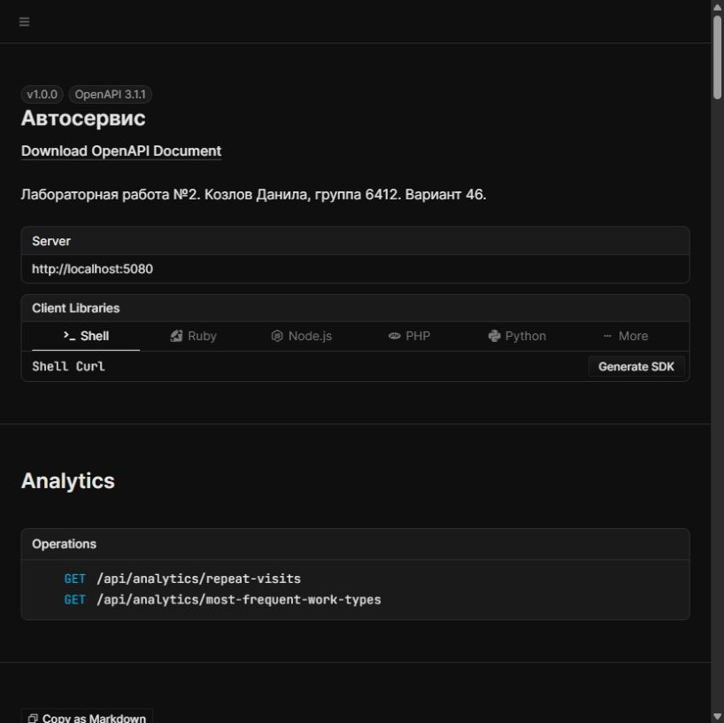

# AutoService — автосервис

Лабораторная работа №2 «Сервер» по курсу [«Разработка корпоративных приложений»](https://github.com/itsecd/enterprise-development).

**Козлов Данила Александрович, группа 6412-100503D. Вариант 46.**
Предметная область — автосервис, СУБД — MySQL, взаимодействие сервисов — gRPC.

Первая работа: [PR №55](https://github.com/itsecd/enterprise-development/pull/55).
Сервер использует её сущности, данные и пять аналитических запросов.
Во второй работе данные хранятся в памяти; после перезапуска изменения теряются.
Подключение MySQL и генератора по gRPC относится к следующим лабораторным.

## Запуск

Нужен .NET 10 SDK. Из корня репозитория:

```shell
dotnet run --project src/AutoService.Api --launch-profile http
```

Интерактивная документация: [http://localhost:5080/scalar](http://localhost:5080/scalar).
Спецификация: [http://localhost:5080/openapi/v1.json](http://localhost:5080/openapi/v1.json).
Документация доступна в окружении `Development`, заданном в профиле запуска.



## Структура

| Проект | Назначение |
| --- | --- |
| `AutoService.Domain` | Клиенты, автомобили, механики, виды работ, заказы; интерфейсы хранилища и начальные данные |
| `AutoService.Contracts` | Входные и выходные DTO, валидация входных данных; без зависимости от Domain |
| `AutoService.Application` | Сервисы: проверка связей, выполнение операций, преобразование в DTO |
| `AutoService.Infrastructure.InMemory` | Репозитории и LINQ-запросы к коллекциям в памяти |
| `AutoService.Api` | Контроллеры ASP.NET Core, обработка ошибок, логирование, OpenAPI и Scalar |
| `AutoService.Tests` | xUnit v3: исходные unit-тесты и интеграционные тесты HTTP API |

Начальные данные общие для сервера и тестов: 10 клиентов, 12 автомобилей,
10 механиков, 12 видов работ и 28 заказов. Каждый сервер получает свой набор объектов.

## CRUD

Для `/api/clients`, `/api/cars`, `/api/mechanics`, `/api/work-types` и `/api/orders`
доступны одинаковые операции:

| Метод | Маршрут | Результат |
| --- | --- | --- |
| GET | `/api/{resource}` | `200`, список записей |
| GET | `/api/{resource}/{id}` | `200`, запись; `404`, если её нет |
| POST | `/api/{resource}` | `201`, созданная запись и заголовок `Location` |
| PUT | `/api/{resource}/{id}` | `204`, полное обновление существующей записи |
| DELETE | `/api/{resource}/{id}` | `204`, удаление записи |

Идентификатор назначает репозиторий. Передавать его в POST или PUT не нужно.
PUT не создаёт отсутствующую запись. Удаление используемой справочной записи
возвращает `409`; сначала нужно удалить связанные заказы и автомобили.

Дополнительные маршруты:

- `/api/clients/{id}/cars`, `/api/clients/{id}/orders`;
- `/api/cars/{id}/owner`, `/api/cars/{id}/orders`;
- `/api/mechanics/{id}/orders`, `/api/mechanics/{id}/clients`;
- `/api/work-types/{id}/orders`, `/api/work-types/{id}/mechanics`;
- `/api/orders/{id}/car`, `/api/orders/{id}/client`, `/api/orders/{id}/mechanic`;
- `/api/orders/{id}/work-types`, `/api/orders/{id}/total-cost`.

## Аналитические запросы

| Запрос из задания | GET-маршрут |
| --- | --- |
| Механики по выбранному виду работ | `/api/work-types/1/mechanics` |
| Клиенты механика в порядке ФИО, без повторов | `/api/mechanics/1/clients` |
| Количество повторных обращений за последний месяц | `/api/analytics/repeat-visits?reportDate=2026-09-27T12:00:00Z` |
| Суммарная стоимость работ заказа | `/api/orders/1/total-cost` |
| Топ-5 самых частых видов работ | `/api/analytics/most-frequent-work-types` |

Месяц для повторных обращений — интервал `[reportDate.AddMonths(-1), reportDate)`.
Первое обращение исключается из полной истории клиента, затем применяется фильтр по датам.
Для приведённой даты результат содержит клиентов `1–8` с количествами `4, 3, 2, 2, 1, 1, 1, 1`.
У заказа №1 стоимость `1600.75`, а топ-5 работ имеет идентификаторы `3, 1, 5, 2, 4`.
При равной частоте первым идёт меньший Id. Работы без заказов не входят в рейтинг.

## Пример заказа

В Scalar откройте `POST /api/orders`, нажмите **Test Request** и отправьте:

```json
{
  "carId": 1,
  "clientId": 1,
  "mechanicId": 1,
  "workTypeIds": [1, 2],
  "acceptedAt": "2026-10-27T10:00:00+03:00",
  "returnedAt": null
}
```

`returnedAt` можно заполнить при PUT, когда автомобиль выдан клиенту.
Дата выдачи должна быть не раньше даты приёма. Все ссылки должны существовать,
клиент нового заказа должен владеть автомобилем, а специализация механика —
соответствовать каждому виду работ. Повторные Id работ не допускаются.

Перечисления передаются строками: `Maintenance`, `Engine`, `Transmission`,
`Electrical`, `Body`, `Tires`. Стоимость задаётся в рублях, продолжительность —
целым числом минут. Проверяются обязательные поля, телефон, паспорт, диапазоны чисел и даты.
Обязательные числовые поля и перечисления во входных DTO nullable, поэтому
пропущенное поле не подменяется нулём или первым элементом перечисления.

Ошибки возвращаются как `application/problem+json`: `400` для неверных данных,
`404` для отсутствующего ресурса, `409` для конфликта связей или уникальных полей.
Неожиданная ошибка даёт `500` без внутренних подробностей. Запросы и ошибки записываются в журнал.

## Обновление связанных данных

При PUT меняются поля существующего объекта, поэтому заказы продолжают ссылаться
на актуальные данные. Изменение цены работы отражается в суммарной стоимости заказа:
фиксация исторической цены в этой модели не предусмотрена.

Смена владельца автомобиля сохраняет клиента в старых заказах. Новый заказ
оформляется на нового владельца. Нельзя изменить специализацию механика или
категорию работы так, чтобы существующие заказы стали некорректными.

Сеанс хранилища блокирует всю операцию сервиса: проверку ссылок, изменение данных
и создание DTO. Это защищает общие коллекции при параллельных HTTP-запросах.
Счётчик Id увеличивается при добавлении и не откатывается после удаления.

## Проверка

```shell
dotnet restore AutoService.slnx
dotnet format AutoService.slnx --verify-no-changes --no-restore
dotnet build AutoService.slnx --configuration Release --no-restore
dotnet test AutoService.slnx --configuration Release --no-build
```

GitHub Actions выполняет эти же проверки. HTTP-тесты поднимают сервер через
`WebApplicationFactory`, поэтому отдельный запуск API для тестов не нужен.
Проверяются CRUD всех сущностей, аналитические результаты, валидация,
целостность связей, параллельное создание, OpenAPI и обработка ошибок.

