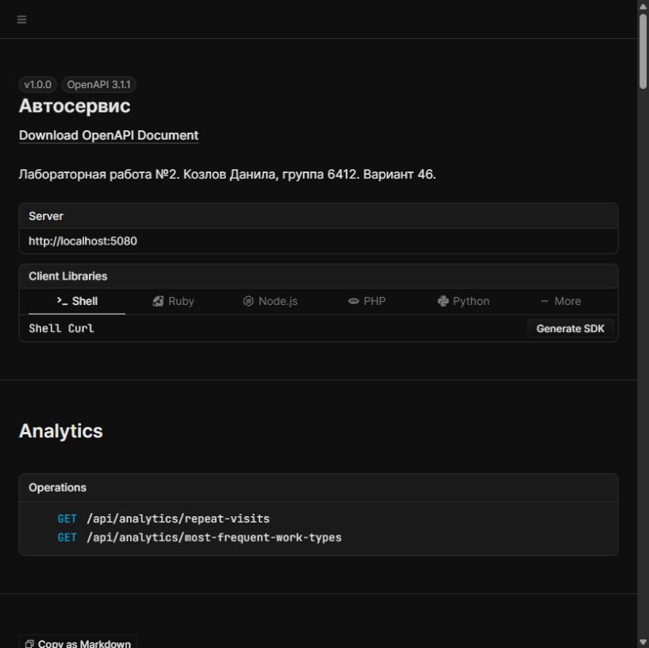

# AutoService — автосервис

Лабораторная работа №3 «ORM» по курсу [«Разработка корпоративных приложений»](https://github.com/itsecd/enterprise-development).

**Козлов Данила Александрович, группа 6412-100503D. Вариант 46.**
Предметная область — автосервис, СУБД — MySQL, взаимодействие сервисов — gRPC.

Предыдущие работы: [классы и LINQ, №55](https://github.com/itsecd/enterprise-development/pull/55),
[REST API, №96](https://github.com/itsecd/enterprise-development/pull/96).
В третьей работе сервер сохраняет данные в MySQL через Entity Framework Core 10.
Генератор по gRPC относится к четвёртой лабораторной.

## Запуск через Aspire

Нужны .NET 10 SDK и запущенный Docker Desktop с Linux-контейнерами
(на Linux — Docker Engine). Из корня репозитория:

```shell
dotnet user-secrets --project src/AutoService.AppHost set "Parameters:mysql-password" "<свой пароль MySQL>"
dotnet run --project src/AutoService.AppHost
```

При первом запуске SDK загрузит инструменты Aspire. Откроется dashboard;
ссылка и токен входа также выводятся в консоль. В списке ресурсов появятся:

1. `mysql` — контейнер MySQL 8.4, данные хранятся в томе `autoservice-mysql-data`;
2. `migrations` — приложение, создающее таблицы и начальные записи;
3. `api` — сервер, запускающийся после успешного завершения миграций.

Откройте HTTP-ссылку ресурса `api` и добавьте `/scalar` для интерактивной документации
или `/openapi/v1.json` для спецификации. Порт назначает Aspire.
Если миграции завершатся с ошибкой, API останется в ожидании.
Перезапуск AppHost сохраняет данные в именованном томе; миграции повторно не добавляют начальные записи.
При смене пароля существующего MySQL нужно также изменить пароль пользователя в самой базе:
параметр контейнера применяется при инициализации пустого тома.

Используется Aspire **13.6.5**: это исправленная версия после 13.5,
у которой NuGet сообщает об [уязвимости dashboard](https://github.com/advisories/GHSA-4g86-54fm-h9h8)
и [уязвимости hosting](https://github.com/advisories/GHSA-f7vh-h5g3-7jrh).
Предупреждения об уязвимостях в проекте не отключены.

Маршруты API из второй работы сохранены:



## Подключение к существующему MySQL

Aspire передаёт строку подключения через `ConnectionStrings__autoservice`.
Для отдельного запуска её можно задать переменной окружения или user-secrets.
Паролей и строк подключения в исходном коде нет. Пример для PowerShell:

```powershell
$env:ConnectionStrings__autoservice = '<строка подключения к своей базе MySQL>'
dotnet run --project src/AutoService.Migrations
dotnet run --project src/AutoService.Api --launch-profile http
```

При таком запуске Scalar доступен по адресу [http://localhost:5080/scalar](http://localhost:5080/scalar).
Миграции применяются отдельным приложением, API самостоятельно схему не изменяет.

## Структура

| Проект | Назначение |
| --- | --- |
| `AutoService.Domain` | Клиенты, автомобили, механики, виды работ, заказы; интерфейсы хранилища и начальные данные |
| `AutoService.Contracts` | Входные и выходные DTO, валидация входных данных; без зависимости от Domain |
| `AutoService.Application` | Сервисы: проверка связей, выполнение операций, преобразование в DTO |
| `AutoService.Infrastructure.MySql` | Контекст EF Core, конфигурации таблиц, миграции и SQL-запросы |
| `AutoService.Migrations` | Однократное применение миграций перед запуском API |
| `AutoService.AppHost` | Оркестрация MySQL, миграций и API через Aspire |
| `AutoService.Infrastructure.InMemory` | Реализация предыдущей лабораторной для unit-тестов; API на неё не ссылается |
| `AutoService.Api` | Контроллеры ASP.NET Core, обработка ошибок, логирование, OpenAPI и Scalar |
| `AutoService.Tests` | xUnit v3: LINQ-тесты, HTTP-проверки на MySQL и проверки миграций |
| `AutoService.AspireTests` | Запуск полного приложения через DistributedApplicationTestingBuilder |

Начальные данные общие для сервера и тестов: 10 клиентов, 12 автомобилей,
10 механиков, 12 видов работ и 28 заказов. Миграция `InitialSchema` создаёт таблицы,
`InitialData` заполняет их. У обеих миграций есть обратные операции.

## Связи и ограничения базы

У автомобиля есть внешний ключ владельца. Заказ ссылается на автомобиль, клиента
и механика. Состав работ хранится в таблице `OrderWorks` с составным первичным ключом:
один вид работ нельзя дважды включить в заказ.
Удаление заказа каскадно удаляет только его строки состава работ.
Для удаления используемого клиента, автомобиля, механика или вида работ стоит `RESTRICT`.

Для строк заданы максимальные длины, согласованные с DTO. Госномер автомобиля и паспорт
механика защищены уникальными индексами. CHECK-ограничения проверяют цену,
продолжительность, стаж, перечисления, год выпуска и порядок дат заказа.
Денежные суммы хранятся как `decimal(12,2)`, продолжительность — как число тиков,
даты — в UTC с точностью до микросекунд. При чтении API возвращает смещение `+00:00`.
Идентификаторы назначает `AUTO_INCREMENT`.

## CRUD

Для `/api/clients`, `/api/cars`, `/api/mechanics`, `/api/work-types` и `/api/orders`
доступны одинаковые операции:

| Метод | Маршрут | Результат |
| --- | --- | --- |
| GET | `/api/{resource}` | `200`, список записей |
| GET | `/api/{resource}/{id}` | `200`, запись; `404`, если её нет |
| POST | `/api/{resource}` | `201`, созданная запись и заголовок `Location` |
| PUT | `/api/{resource}/{id}` | `204`, полное обновление существующей записи |
| DELETE | `/api/{resource}/{id}` | `204`, удаление записи |

Идентификатор назначает репозиторий. Передавать его в POST или PUT не нужно.
PUT не создаёт отсутствующую запись. Удаление используемой справочной записи
возвращает `409`; сначала нужно удалить связанные заказы и автомобили.

Дополнительные маршруты:

- `/api/clients/{id}/cars`, `/api/clients/{id}/orders`;
- `/api/cars/{id}/owner`, `/api/cars/{id}/orders`;
- `/api/mechanics/{id}/orders`, `/api/mechanics/{id}/clients`;
- `/api/work-types/{id}/orders`, `/api/work-types/{id}/mechanics`;
- `/api/orders/{id}/car`, `/api/orders/{id}/client`, `/api/orders/{id}/mechanic`;
- `/api/orders/{id}/work-types`, `/api/orders/{id}/total-cost`.

## Аналитические запросы

| Запрос из задания | GET-маршрут |
| --- | --- |
| Механики по выбранному виду работ | `/api/work-types/1/mechanics` |
| Клиенты механика в порядке ФИО, без повторов | `/api/mechanics/1/clients` |
| Количество повторных обращений за последний месяц | `/api/analytics/repeat-visits?reportDate=2026-09-27T12:00:00Z` |
| Суммарная стоимость работ заказа | `/api/orders/1/total-cost` |
| Топ-5 самых частых видов работ | `/api/analytics/most-frequent-work-types` |

Месяц для повторных обращений — интервал `[reportDate.AddMonths(-1), reportDate)`.
Первое обращение исключается из полной истории клиента, затем применяется фильтр по датам.
Для приведённой даты результат содержит клиентов `1–8` с количествами `4, 3, 2, 2, 1, 1, 1, 1`.
У заказа №1 стоимость `1600.75`, а топ-5 работ имеет идентификаторы `3, 1, 5, 2, 4`.
При равной частоте первым идёт меньший Id. Работы без заказов не входят в рейтинг.

## Пример заказа

В Scalar откройте `POST /api/orders`, нажмите **Test Request** и отправьте:

```json
{
  "carId": 1,
  "clientId": 1,
  "mechanicId": 1,
  "workTypeIds": [1, 2],
  "acceptedAt": "2026-10-27T10:00:00+03:00",
  "returnedAt": null
}
```

`returnedAt` можно заполнить при PUT, когда автомобиль выдан клиенту.
Дата выдачи должна быть не раньше даты приёма. Все ссылки должны существовать,
клиент нового заказа должен владеть автомобилем, а специализация механика —
соответствовать каждому виду работ. Повторные Id работ не допускаются.

Перечисления передаются строками: `Maintenance`, `Engine`, `Transmission`,
`Electrical`, `Body`, `Tires`. Стоимость задаётся в рублях, продолжительность —
целым числом минут. Проверяются обязательные поля, телефон, паспорт, диапазоны чисел и даты.
Обязательные числовые поля и перечисления во входных DTO nullable, поэтому
пропущенное поле не подменяется нулём или первым элементом перечисления.

Ошибки возвращаются как `application/problem+json`: `400` для неверных данных,
`404` для отсутствующего ресурса, `409` для конфликта связей или уникальных полей.
Неожиданная ошибка даёт `500` без внутренних подробностей. Запросы и ошибки записываются в журнал.

## Обновление связанных данных

При PUT меняются поля существующего объекта, поэтому заказы продолжают ссылаться
на актуальные данные. Изменение цены работы отражается в суммарной стоимости заказа:
фиксация исторической цены в этой модели не предусмотрена.

Смена владельца автомобиля сохраняет клиента в старых заказах. Новый заказ
оформляется на нового владельца. Нельзя изменить специализацию механика или
категорию работы так, чтобы существующие заказы стали некорректными.

Операции чтения, в том числе аналитика, выполняются через ExecuteReadAsync без явной транзакции.
Проверка связей, изменение записи и формирование ответа выполняются через ExecuteWriteAsync в одной транзакции
с уровнем изоляции Serializable. При ошибке изменения откатываются.
Временные взаимные блокировки повторяются стратегией EF Core; нарушения уникальности
и внешних ключей возвращаются как безопасный `409` без текста SQL.

Фильтры, группировки, подсчёт повторных визитов, топ-5 и сумма стоимости выполняются в MySQL.
Для определения повторного визита проверяется наличие более раннего заказа того же клиента;
при равном времени порядок определяется по Id. В память загружается результат запроса.

## Проверка

```shell
dotnet restore AutoService.slnx
dotnet format AutoService.slnx --verify-no-changes --no-restore
dotnet build AutoService.slnx --configuration Release --no-restore
```

Для HTTP-тестов нужен отдельный MySQL 8.4. В `ConnectionStrings__testmysql` укажите
подключение пользователя с правом создания и удаления тестовых баз:

```powershell
$env:ConnectionStrings__testmysql = '<подключение к тестовому серверу MySQL>'
dotnet test tests/AutoService.Tests --configuration Release --no-build
```

Каждый HTTP-тест создаёт базу с уникальным именем `autoservice_test_*`, применяет
к ней обе миграции и удаляет базу после завершения. Существующая база приложения не очищается.
Проверяются CRUD, связанные маршруты, аналитика, валидация, уникальность,
обновление связей, откат миграции данных и сохранение записи между экземплярами API.
Unit-тесты первой работы сохранены.

При запущенном Docker дополнительно можно проверить сам Aspire:

```shell
dotnet test tests/AutoService.AspireTests --configuration Release --no-build
```

Этот тест ссылается на AppHost, запускает контейнер MySQL, ждёт миграций и готовности API,
проверяет исходные заказы, сумму работ и создание клиента. Используется временный контейнер
без постоянного тома и отдельный случайный пароль. Это тест через `Aspire.Hosting.Testing`,
а не только через `WebApplicationFactory`.

GitHub Actions поднимает MySQL для HTTP-тестов и отдельно проверяет запуск Aspire.
Результаты сохраняются в артефакты workflow.

## Работа с миграциями

Для `dotnet ef` используется фабрика контекста, читающая `ConnectionStrings__autoservice`.
После установки инструмента `dotnet-ef` версии 10.0.14:

```shell
dotnet ef migrations add MigrationName --project src/AutoService.Infrastructure.MySql
dotnet ef database update --project src/AutoService.Infrastructure.MySql
```

Учтённые замечания из ревью других третьих работ собраны в [docs/lab3-review-notes.md](docs/lab3-review-notes.md).
